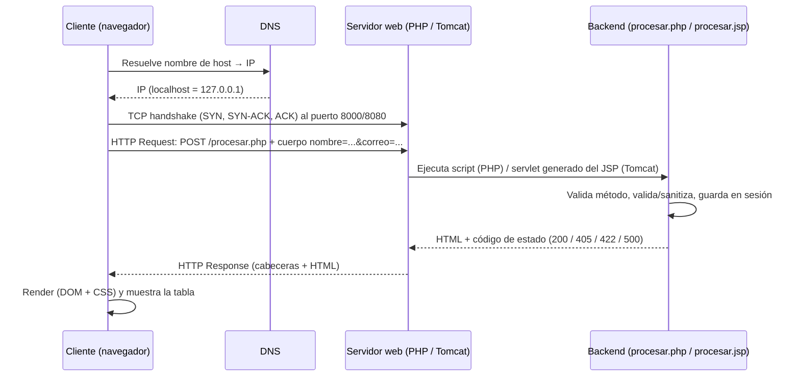

# Lab 09A – Sistema de Registro de Contacto (PHP vs JSP)

**Universidad Nacional del Centro del Perú – Facultad de Ingeniería de Sistemas**
Asignatura: Desarrollo de Aplicaciones Web (IS093A) · Unidad II · Guía Práctica Grupal Semana 09

**Integrantes:** _(completar: Apellidos y Nombres – rol técnico)_

| Rol | Integrante |
|---|---|
| Arquitecto de Despliegue | |
| Desarrollador PHP | |
| Desarrollador JSP | |
| QA & Documentador | |

---

## 1. Estructura del proyecto

```
lab09-registro-contacto/
├── php-app/
│   ├── index.html      # Formulario (POST → procesar.php)
│   ├── procesar.php    # Validación, sanitización, $_SESSION, tabla
│   ├── lib.php         # Helpers: e() = htmlspecialchars, páginas y errores 4xx/5xx
│   ├── router.php      # Router del servidor embebido (404/403)
│   └── style.css
├── jsp-app/
│   ├── index.jsp       # Formulario (POST → procesar.jsp)
│   ├── procesar.jsp    # request, HttpSession, <c:forEach>, <c:out>
│   ├── error.jsp       # Página de errores 4xx/5xx
│   ├── style.css
│   └── WEB-INF/
│       ├── web.xml     # welcome-file, sesión, error-page
│       └── lib/jstl-1.2.jar   # (lo descarga setup-termux.sh)
├── scripts/            # setup, run, stop y pruebas HTTP
├── capturas/           # capturas de pantalla / logs para el informe
└── README.md
```

> Nota: la guía menciona `registro.php/jsp` en el enunciado, pero el código base a refactorizar usa `procesar.php/jsp`; se mantuvo `procesar.*`.

## 2. Despliegue en Termux

```bash
# 1) Instalar dependencias (PHP, JDK 17, Tomcat 9, JSTL) – solo una vez
bash scripts/setup-termux.sh

# 2) PHP  →  http://localhost:8000
bash scripts/run-php.sh

# 3) JSP  →  http://localhost:8080/jsp-app/   (abrir otra sesión de Termux)
bash scripts/run-jsp.sh
bash scripts/stop-jsp.sh        # para detener Tomcat

# 4) QA: pruebas HTTP (con el servidor correspondiente activo)
bash scripts/pruebas-http.sh php
bash scripts/pruebas-http.sh jsp
```

| Elemento | PHP | JSP |
|---|---|---|
| Servidor | PHP built-in server (equivale a XAMPP/Apache en PC) | Apache Tomcat 9.0.x |
| Puerto | 8000 | 8080 |
| Ruta de despliegue | `php-app/` (equivale a `htdocs/`) | `~/tomcat9/webapps/jsp-app/` |
| Logs | `logs/php-server.log` | `~/tomcat9/logs/catalina.out`, `localhost_access_log.*.txt` |

En PC con XAMPP: copiar `php-app/` a `C:\xampp\htdocs\` y `jsp-app/` a `webapps/` de Tomcat (puertos 80/8080).

## 3. Ciclo de vida de una petición HTTP



Resumen: **Cliente → DNS → TCP/IP → HTTP Request → Servidor → Backend → Response → Render**.

## 4. Seguridad básica

| Control | PHP | JSP |
|---|---|---|
| Solo método POST | `$_SERVER['REQUEST_METHOD'] !== 'POST'` → 405 + `Allow: POST` | `request.getMethod()` → `sendError(405)` |
| Prevención XSS (salida) | `htmlspecialchars(..., ENT_QUOTES, 'UTF-8')` vía `e()` | `<c:out value="${...}"/>` (escapeXml=true) |
| Validación de entrada | `filter_input`, `FILTER_VALIDATE_EMAIL`, regex Unicode, longitudes | `Pattern` (regex) y longitudes |
| Sanitización | `trim` + eliminación de caracteres de control | `trim` + `\p{Cntrl}` |
| Errores 4xx/5xx | `error_http()` + `try/catch` (500 sin filtrar detalles) | `web.xml` `<error-page>` → `error.jsp` |
| Sesión | cookie `HttpOnly` + `SameSite=Lax` | `<http-only>true</http-only>` |
| Límite de datos | máx. 50 registros por sesión | máx. 50 registros por sesión |

Códigos usados: **405** método no permitido · **422** datos inválidos · **404** no encontrado · **403** acceso prohibido (PHP) · **500** error interno.

## 5. Matriz comparativa PHP vs JSP

| Criterio | PHP | JSP |
|---|---|---|
| Ciclo de vida | Cada petición ejecuta el script desde cero (share-nothing). | El JSP se traduce y compila a un Servlet una vez; luego una instancia atiende múltiples hilos (`init → service → destroy`). |
| Rendimiento | Arranque rápido, bajo consumo; OPcache/JIT en PHP 8. | Primera petición más lenta (compilación) y más memoria (JVM), pero muy eficiente en carga sostenida. |
| Despliegue | Copiar archivos a `htdocs/` o al docroot; cero compilación. | Empaquetar WAR o carpeta en `webapps/`; requiere JDK, Tomcat y `web.xml`/anotaciones. |
| Gestión de estado | `$_SESSION` (archivos en disco por defecto; Redis/BD opcional). | `HttpSession` en memoria del contenedor (objetos Java); soporta clustering/persistencia. |
| Seguridad (XSS) | Escape manual con `htmlspecialchars`. | `<c:out>`/EL con JSTL escapa por defecto; EL sin `c:out` **no** escapa. |
| Tipado y errores | Dinámico (tipado opcional en PHP 8). | Estático (Java), errores de compilación tempranos. |
| Madurez del ecosistema | Composer/Packagist, Laravel, Symfony, WordPress; hosting barato y masivo. | Jakarta EE, Spring, Maven/Gradle; fuerte en entornos empresariales y bancarios. |
| Curva de aprendizaje | Baja. | Media-alta. |

## 6. Evidencias (completar con capturas)

Guardar en `capturas/`: formulario y tabla de PHP y JSP, salida de `pruebas-http.sh`, logs (`php-server.log`, `catalina.out`, `localhost_access_log`) y `tree` de carpetas.

```bash
bash scripts/pruebas-http.sh php | tee capturas/pruebas-php.txt
bash scripts/pruebas-http.sh jsp | tee capturas/pruebas-jsp.txt
curl -i -X POST -d "nombre=Ana&correo=ana@mail.com" http://localhost:8000/procesar.php
```

## 7. Subir a GitHub desde Termux

```bash
cd lab09-registro-contacto
git config --global user.name "Tu Nombre"
git config --global user.email "tu@correo.com"
git init
git add .
git commit -m "Lab 09: Sistema de Registro de Contacto PHP y JSP"
git branch -M main
git remote add origin https://github.com/TU_USUARIO/lab09-registro-contacto.git
git push -u origin main      # usuario: TU_USUARIO · contraseña: Personal Access Token
```

El token se crea en GitHub → Settings → Developer settings → Personal access tokens (permiso `repo`).
