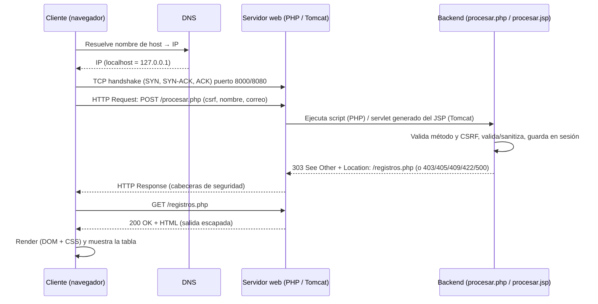

# Lab 09A – Sistema de Registro de Contacto (PHP vs JSP)

**Universidad Nacional del Centro del Perú – Facultad de Ingeniería de Sistemas**
Asignatura: Desarrollo de Aplicaciones Web (IS093A) · Unidad II · Guía Práctica Grupal Semana 09

> Versión mejorada en la rama `hinojosa` (ver sección 3, *Mejoras*).

**Integrantes:** _(completar: Apellidos y Nombres – rol técnico)_

| Rol | Integrante |
|---|---|
| Arquitecto de Despliegue | |
| Desarrollador PHP | |
| Desarrollador JSP | |
| QA & Documentador | |

---

## 1. Estructura del proyecto

```
lab09-registro-contacto/
├── php-app/
│   ├── index.php       # Formulario + token CSRF
│   ├── procesar.php    # POST: CSRF, validación, sanitización, $_SESSION, 303
│   ├── registros.php   # Tabla de registros (GET) con botones eliminar
│   ├── eliminar.php    # POST: eliminar uno / todos
│   ├── lib.php         # Helpers: e(), CSRF, flash, cabeceras, errores 4xx/5xx
│   ├── router.php      # Router del servidor embebido (404/403)
│   └── style.css
├── jsp-app/
│   ├── index.jsp, procesar.jsp, registros.jsp, eliminar.jsp, error.jsp, style.css
│   └── WEB-INF/
│       ├── web.xml           # welcome-file, sesión, error-page (403/404/405/409/422/500)
│       ├── jspf/             # comun (CSRF + cabeceras), encabezado, pie
│       └── lib/jstl-1.2.jar  # (lo descarga setup-termux.sh)
├── scripts/            # setup, run, stop y pruebas HTTP
├── capturas/           # capturas de pantalla / logs para el informe
└── README.md
```

## 2. Despliegue en Termux

```bash
bash scripts/setup-termux.sh          # una sola vez: PHP, JDK 21, Tomcat 9, JSTL
bash scripts/run-php.sh               # http://localhost:8000
bash scripts/run-jsp.sh               # http://localhost:8080/jsp-app/  (otra sesión)
bash scripts/stop-jsp.sh              # detener Tomcat
bash scripts/pruebas-http.sh php      # QA (con el servidor activo)
bash scripts/pruebas-http.sh jsp
```

| Elemento | PHP | JSP |
|---|---|---|
| Servidor | PHP built-in server (equivale a XAMPP/Apache) | Apache Tomcat 9.0.x |
| Puerto | 8000 | 8080 |
| Despliegue | `php-app/` (≈ `htdocs/`) | `~/tomcat9/webapps/jsp-app/` |
| Logs | `logs/php-server.log` | `~/tomcat9/logs/catalina.out`, `localhost_access_log.*.txt` |

## 3. Mejoras de la rama `hinojosa` respecto a `main`

| Mejora | PHP | JSP |
|---|---|---|
| Protección **CSRF** (token por sesión, comparación en tiempo constante) | `csrf_token()` / `hash_equals` | `comun.jspf` / `MessageDigest.isEqual` |
| **Post/Redirect/Get** (303): refrescar ya no reenvía el formulario | `redirigir()` | `Location` + estado 303 |
| Mensajes *flash* tras guardar/eliminar | `$_SESSION['flash']` | atributo de sesión `flash` |
| Detección de **correos duplicados** (409 Conflict) | sí | sí |
| **Eliminar** un registro o todos (POST + CSRF) | `eliminar.php` | `eliminar.jsp` |
| **Cabeceras de seguridad** (CSP, X-Frame-Options, nosniff, Referrer-Policy) | `cabeceras_seguridad()` | `comun.jspf` |
| Cookie de sesión `HttpOnly` (+ `SameSite=Lax` en PHP) | sí | `web.xml` |
| Más códigos de error con página propia: 403, 409 | sí | `web.xml` |
| UI responsive, modo oscuro, navegación, tabla con scroll horizontal | `style.css` | `style.css` |
| Vistas reutilizables en JSP (sin repetir HTML) | — | `encabezado.jspf` / `pie.jspf` |
| Pruebas HTTP ampliadas (CSRF, duplicado, eliminar, cabeceras) | `pruebas-http.sh` | `pruebas-http.sh` |
| Fix: `require_once` (evita "Cannot redeclare function e()" con el router) | sí | — |

## 4. Ciclo de vida de una petición HTTP



Resumen: **Cliente → DNS → TCP/IP → HTTP Request → Servidor → Backend → Response → Render**.

## 5. Seguridad básica

| Control | PHP | JSP |
|---|---|---|
| Solo método POST | `solo_post()` → 405 + `Allow: POST` | `request.getMethod()` → `sendError(405)` |
| CSRF | token de sesión en campo oculto → 403 si falta/no coincide | ídem |
| Prevención XSS (salida) | `htmlspecialchars(..., ENT_QUOTES, 'UTF-8')` vía `e()` | `<c:out>` (escapeXml=true) |
| Validación de entrada | `filter_input`, `FILTER_VALIDATE_EMAIL`, regex Unicode, longitudes | `Pattern` y longitudes |
| Sanitización | `trim` + eliminación de caracteres de control | `trim` + `\p{Cntrl}` |
| Errores 4xx/5xx | `error_http()` + `try/catch` (500 sin detalles) | `web.xml` `<error-page>` → `error.jsp` |
| Cabeceras | CSP, X-Frame-Options, nosniff, Referrer-Policy | ídem |
| Sesión | cookie `HttpOnly` + `SameSite=Lax` | `<http-only>true</http-only>` |
| Límite de datos | máx. 50 registros por sesión | ídem |

Códigos usados: **303** redirección tras POST · **403** CSRF/acceso prohibido · **404** no encontrado · **405** método no permitido · **409** correo duplicado · **422** datos inválidos · **500** error interno.

## 6. Matriz comparativa PHP vs JSP

| Criterio | PHP | JSP |
|---|---|---|
| Ciclo de vida | Cada petición ejecuta el script desde cero (share-nothing). | El JSP se traduce y compila a un Servlet una vez; una instancia atiende múltiples hilos (`init → service → destroy`). |
| Rendimiento | Arranque rápido, bajo consumo; OPcache/JIT en PHP 8. | Primera petición más lenta (compilación) y más memoria (JVM), muy eficiente en carga sostenida. |
| Despliegue | Copiar archivos a `htdocs/`; cero compilación. | WAR o carpeta en `webapps/`; requiere JDK, Tomcat y `web.xml`/anotaciones. |
| Gestión de estado | `$_SESSION` (archivos en disco; Redis/BD opcional). | `HttpSession` en memoria del contenedor (objetos Java); clustering/persistencia. |
| Seguridad (XSS) | Escape manual con `htmlspecialchars`. | `<c:out>` escapa por defecto; EL sin `c:out` **no** escapa. |
| Tipado y errores | Dinámico (tipado opcional en PHP 8). | Estático (Java), errores de compilación tempranos. |
| Ecosistema | Composer/Packagist, Laravel, Symfony, WordPress; hosting masivo y barato. | Jakarta EE, Spring, Maven/Gradle; fuerte en entornos empresariales. |
| Curva de aprendizaje | Baja. | Media-alta. |

## 7. Evidencias (completar con capturas)

```bash
bash scripts/pruebas-http.sh php | tee capturas/pruebas-php.txt
bash scripts/pruebas-http.sh jsp | tee capturas/pruebas-jsp.txt
```
Guardar en `capturas/`: formularios, tablas, salida de pruebas, logs y `tree`.
